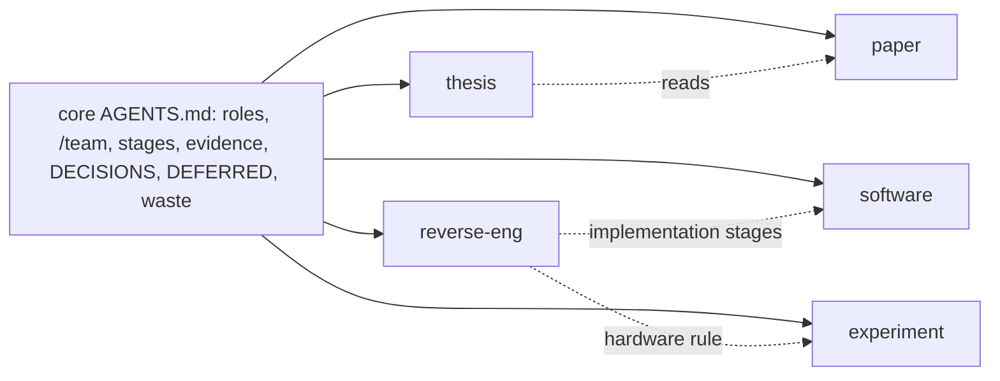
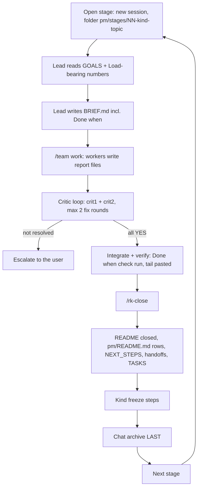
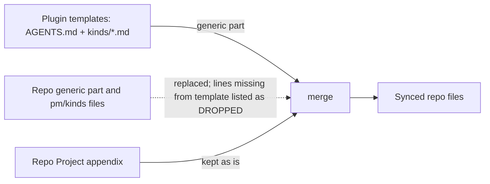
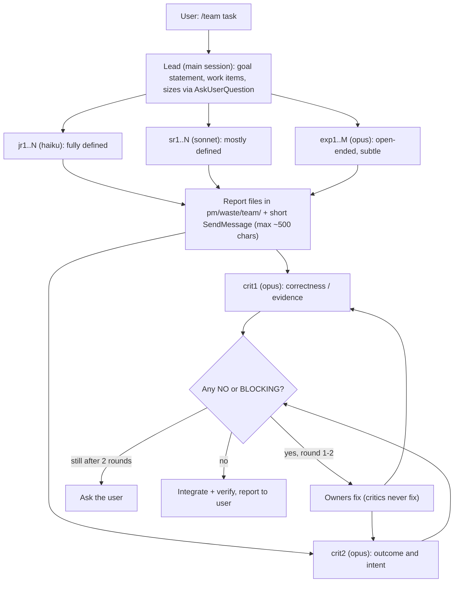
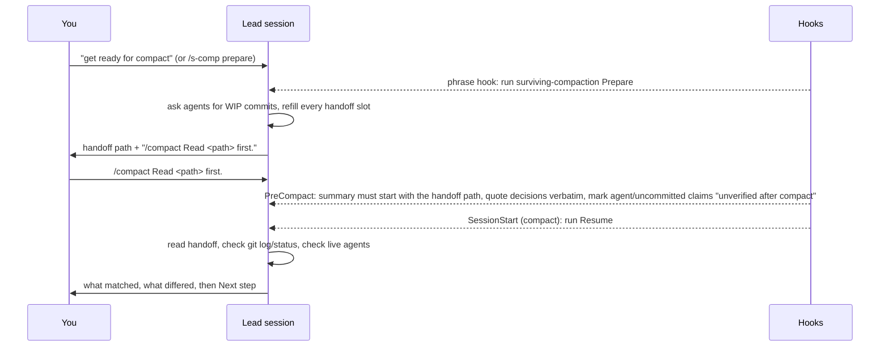

# research-kit

Built with AI assistance (Claude Code).

A Claude Code marketplace for running science and lab projects with agent
teams: papers, research software, driver reverse engineering, experiments and
theses, alone or mixed in one repo. It ships a generic process file
(`AGENTS.md`), one short rule file per project kind, a `pm/` process folder,
a `/team` skill (named workers plus two opus critics with different lenses),
worker agents pinned to an effort level, a "waste, don't delete" helper and
compaction handoff hooks.

License: MIT (see `LICENSE`).

## Contents

- [Plugins](#plugins)
- [Install](#install)
  - [Quick start](#quick-start)
  - [Enable agent teams (needed by `/team`)](#enable-agent-teams-needed-by-team)
  - [Updating](#updating)
- [Kinds](#kinds)
- [ARS integration (`paper`, `thesis`)](#ars-integration-paper-thesis)
- [Example: a paper with a code part, end to end](#example-a-paper-with-a-code-part-end-to-end)
- [Zotero (`research-kit-lit`)](#zotero-research-kit-lit)
- [Light vs full](#light-vs-full)
- [The `pm/` folder](#the-pm-folder)
- [Commands](#commands)
- [Stage lifecycle](#stage-lifecycle)
- [How sync works](#how-sync-works)
- [/team flow](#team-flow)
- [Best practices for teams](#best-practices-for-teams)
- [Surviving compaction](#surviving-compaction)
- [Deleting is off](#deleting-is-off)
- [Optional external tools](#optional-external-tools)
- [Development](#development)

## Plugins

| Plugin | Contents |
|---|---|
| `research-kit` (core) | skills `research-kit`, `team`, `waste`, `surviving-compaction`; commands `rk-*`, `s-comp`; agents `worker-{low,medium,high,xhigh}`; hooks; all kind files |
| `research-kit-lit` (optional) | skill `zotero` (tested Zotero MCP procedure, preflight, stop conditions), agent `zotero-worker`; for the `paper` and `thesis` kinds |

Skills also answer to their bare name (`/team`) unless another skill already
uses it. Agents only answer to the `research-kit:` name.

## Install

```
/plugin marketplace add xylophoneengine/research-kit
/plugin install research-kit@research-kit
/plugin install research-kit-lit@research-kit     # optional, Zotero users
```

From a local clone instead: `/plugin marketplace add /path/to/research-kit`.

Then restart Claude Code (or `/reload-plugins`). Requirements: `bash`, `jq`,
`python3` (stdlib only), `git`.

### Quick start

1. Enable agent teams (below), restart.
2. In your project repo (must be a git repo): `/rk-init`. Pick kinds, light or
   full, and who commits.
3. Start work: `/team <task>` (or `/team juniors=1 critics=1 <task>` for a
   small one). In full mode, open a stage first (see Stage lifecycle).
4. Before a compact say `get ready for compact`; after it the session resumes
   from the handoff file.
5. When the plugin updates: `/rk-sync` (dry run), sort DROPPED lines, then
   `/rk-sync --write`.

### Enable agent teams (needed by `/team`)

`/team` spawns named teammates that stay addressable (`SendMessage`) and can be
reused across rounds. That is Claude Code's experimental agent-teams feature;
without it a named spawn is a one-shot subagent. Turn it on in
`~/.claude/settings.json` (merge into an existing `env` block):

```json
{
  "env": {
    "CLAUDE_CODE_EXPERIMENTAL_AGENT_TEAMS": "1"
  }
}
```

Restart Claude Code. Check: in a new session, `/team juniors=1 critics=0 <tiny task>`
should show a teammate named `jr1` that you can message after it finishes.

### Updating

Plugins install as a copy. After pulling a new version (or editing a local
clone), run `claude plugin marketplace update research-kit`, then
`/plugin` -> update `research-kit` (and `research-kit-lit`), and restart.

## Kinds

One file per kind, copied to `pm/kinds/<kind>.md` in your repo. Add kinds as
the repo grows; stages of different kinds can run in parallel.

| Kind | For | Core ideas |
|---|---|---|
| `paper` | writing a research paper | literature pipeline, writing stages, citation rules, reference manager |
| `software` | apps, libraries, tools built by an orchestrator plus implementers | spec and failing test first, tests never weakened, gate script, git policy |
| `reverse-eng` | reimplementing a vendor-closed driver or protocol | scope statement, pinned vendor material, capture first, `PROTOCOL.md`, fake transport and replay |
| `experiment` | measuring on a rig, instrument or simulator | agents never touch hardware unless the user explicitly tells them to, run records, dry runs not quotable, write-once analysis |
| `thesis` | assembling a thesis | paper kind plus carrying evidence tags and stage notes over from earlier projects |



Every kind file stays under about 150 lines and is read once per session; the
appendix of `AGENTS.md` lists the active kinds.

## ARS integration (`paper`, `thesis`)

The `paper` kind runs its literature and writing stages on the
[academic-research-skills](https://github.com/Imbad0202/academic-research-skills)
plugin (ARS). Full rules: `pm/kinds/paper.md` sections P0, P2 and P5.8.

- First session in a paper repo: the lead checks ARS is installed and stops if not.
- ARS runs inside the team model, not beside it: interactive modes (plan,
  Socratic dialogue) run in the lead session; modes that write a deliverable run
  in a named teammate; critics review every ARS deliverable like any other.
- Invoke the parent skill with a mode argument on the session model (most light
  `/ars-*` commands pin a smaller model). Outputs go to the stage folder; the
  stage README records skill + mode + version.
- ARS reads your sources only through a Material Passport (`passport.yaml`)
  built from the ledger by a converter script and rebuilt after every ledger
  change; without it ARS searches external databases instead.

| Paper stage | ARS skill (mode) |
|---|---|
| goal + lit-scan | `deep-research` (`three-way-scan` / `lit-review`; `socratic` optional) |
| scan update | `deep-research` (`three-way-scan` / `lit-review` / `fact-check`) |
| plan | `academic-paper` (`plan`), lead session |
| outline | `academic-paper` (`outline-only`) |
| full draft | `academic-paper` (`full`); `academic-pipeline` only phase by phase |
| review | `academic-paper-reviewer` (`full` / `methodology-focus`) |
| revision | `academic-paper` (`revision` / `revision-coach` / `rebuttal-audit`), then reviewer `re-review` |
| finalize | `academic-paper` (`abstract-only`, `citation-check`, `disclosure`, `format-convert`) |
| systematic reviews only | `sr-screener` (ARS >= 3.23.0), on user request |

Seed, source-sync and benchmark stages use no ARS. The `thesis` kind reuses
the paper pipeline.

## Example: a paper with a code part, end to end

One repo, kinds `paper` + `software`, full mode. One stage per session; each
stage opens in a fresh session named after its folder (`/rename`).

| Session | You type | What happens |
|---|---|---|
| setup | `/rk-init` (kinds: paper; full; user commits) | `pm/` tree, appendix, `.gitignore` block. Paper first-session steps: ARS check, library tag asked (e.g. `mypaper`), appendix lines (title, venue, authors, topic) |
| 01 | `/rename MYP_01_paper_goal-scan`, then "open stage: goal + lit-scan" | Lead writes `BRIEF.md` with a `Done when`. Lead runs the GOALS dialogue (`deep-research`, `socratic`) and writes `pm/living/GOALS.md`; you confirm. `/team`: a teammate runs `deep-research` `three-way-scan` into `deliverables/`; crit1 + crit2 review into `notes/` |
| | "close stage" (or `/rk-close 01`) | Close checklist: stage README marked closed, `pm/README.md` rows, NEXT_STEPS, handoffs, chat archive last. Stage is frozen |
| 02 | "open stage: source sync" | `/team` with `research-kit-lit:zotero-worker` teammates: preflight, import, tag, ledger = PDFs = library entries; corpus passport rebuilt for ARS |
| 03 | `/rk-add-kind software`, "open stage: software solver" | Software kind in parallel (one open stage per kind): design via `superpowers:brainstorming` or grilling, plan via `writing-plans`, build via `/team`; numbers stamped at a clean commit go to "Load-bearing numbers" in `pm/README.md` |
| 04 | "open stage: plan" | `academic-paper` `plan` in the lead session (dialogue with you): `chapter_plan.md`, `insight_collection.md`; your decisions logged verbatim in `pm/DECISIONS.md` |
| 05-06 | "open stage: outline", then "full draft" | `academic-paper` `outline-only`, then `full`, each in a named writer teammate, reading the passport; every claim in `claims_register.md` has an owner file |
| 07-08 | "open stage: review", then "revision" | `academic-paper-reviewer` `full`, then `academic-paper` `revision` + reviewer `re-review` |
| 09 | "open stage: finalize" | `abstract-only`, `citation-check`, `disclosure`, `format-convert`; done when `citation-check` has no open error |

Any session: "get ready for compact" writes a handoff in `pm/handoffs/compact/`,
then `/compact`, and the session resumes from it. A blocker or a decision only
you can make goes to `pm/DECISIONS.md` (escalation) or `pm/DEFERRED.md`; the
lead asks instead of guessing.

After stage 03 the repo looks like:

```
pm/stages/01-paper-goal-scan/       closed: BRIEF, README, deliverables/scans, notes/critic reviews
pm/stages/02-paper-source-sync/     closed: ledger sync check, passport
pm/stages/03-software-solver/       open:   plan, code, run sheet, numbers
pm/living/GOALS.md  pm/living/paper_ledger.md  pm/README.md (Load-bearing numbers)
paper/library/pdfs/                 (manuscript/ appears at the draft stage)
```

Light mode works the same without stage folders: `/team` tasks, critics into
`pm/reviews/`, the stage tables as a checklist.

## Zotero (`research-kit-lit`)

Optional add-on for kinds that keep a literature library. It drives
[Zotero](https://www.zotero.org) through the
[Zotero MCP server](https://github.com/54yyyu/zotero-mcp) (`zotero-mcp-server`,
tested 0.15.2) and enforces one hard rule: **PDF and file bodies never go to
zotero.org storage** (small quota); files sync through your own WebDAV server.

Setup, once per machine:

1. Zotero desktop: Settings > Sync > File Syncing = WebDAV (your server);
   Settings > Advanced > allow other applications to communicate with Zotero
   (local API on `127.0.0.1:23119`). Local MCP writes need a recent Zotero.
2. Install the server into its own environment (see its README), e.g.
   `python3 -m venv ~/venvs/zotero && ~/venvs/zotero/bin/pip install zotero-mcp-server`.
3. Register it with Claude Code under the name `zotero`, in local mode, with the
   SQLite search backend and an empty API key (the empty key masks any key your
   shell exports, so the MCP has no path to zotero.org):

   ```
   claude mcp add zotero -s user \
     -e ZOTERO_LOCAL=true -e ZOTERO_SEARCH_BACKEND=sqlite -e ZOTERO_API_KEY= \
     -- ~/venvs/zotero/bin/zotero-mcp
   ```
4. Optional, only for the preflight's `--file-check`: a read-only
   `ZOTERO_API_KEY` and `ZOTERO_LIBRARY_ID` exported in your shell, never in the
   MCP env.

Use:

- The `zotero` skill holds the tested procedure: preflight script
  (`skills/zotero/scripts/preflight.py`, run before the first write each
  session), recipes, stop conditions and pitfalls. Load it before any write.
- Teammates that touch Zotero run as agent type `research-kit-lit:zotero-worker`
  (stop conditions built in).
- Any doubt (hybrid/web mode, "Web API credentials: set", quota or zotero.org
  text in an error): the agent stops and asks you; it never works around it.
- Group libraries: WebDAV serves My Library only, so group items get tags, not
  attachments.

## Light vs full

Chosen at `/rk-init`, stored as `Mode:` in the appendix.

Light keeps roles, `/team`, both critics, evidence tags, `pm/DECISIONS.md`,
`pm/DEFERRED.md`, logs and handoffs; full adds stage folders, stage tables and
the close checklist.

`/rk-upgrade` turns light into full; nothing is downgraded.

## The `pm/` folder

```
pm/
  README.md         finding aid: stages, "Load-bearing numbers", "Do not quote"   committed
  DECISIONS.md      decision log + escalation format                              committed
  DEFERRED.md       parked items (approval, hardware, money)                      committed
  living/           GOALS, NEXT_STEPS, TASKS, edited in place                     committed
  kinds/            active kind files (replaced on sync)                          committed
  stages/NN-<kind>-<topic>/                                                       committed, except chat/
    README.md BRIEF.md deliverables/ notes/ code/ chat/                           chat/ gitignored
  handoffs/open/    work packages for later sessions                              committed
  handoffs/done/    executed work packages                                        committed
  handoffs/compact/ compaction handoffs                                           gitignored
  logs/             run and implementation logs                                   committed
  reviews/          critic reviews outside stages (light mode)                    gitignored
  scratch/          throwaway work                                                gitignored
  waste/            discarded files + LEDGER.md; team/ = teammate reports         gitignored
```

`rk-init` also appends a marked block to `.gitignore` (`pm/waste/`,
`pm/handoffs/compact/`, `pm/scratch/`, `pm/reviews/`, `pm/stages/*/chat/`,
`_dry/`); rerunning it never duplicates the block or touches your lines.

## Commands

| Command | Does |
|---|---|
| `/rk` | menu: shows the options below for the repo's state and runs your choice (start here). Full name `/research-kit:rk`; on first use it offers a personal `/rk` shortcut (`~/.claude/commands/rk.md`) so it ranks first in the slash menu |
| `/rk-init` | asks kinds, mode and git policy, then creates `pm/`, the appendix fields, the kinds block, the `.gitignore` block |
| `/rk-add-kind <kind>` | activates another kind (no-op if already active; unknown kind lists the valid ids) |
| `/rk-upgrade` | light to full: adds `pm/stages/`, flips `Mode:` |
| `/rk-sync` | updates `AGENTS.md` and the kind files from the plugin templates (see below) |
| `/rk-close` | closes a named stage with the close checklist |
| `/s-comp prepare` / `resume` | compaction handoff before and after `/compact` |

## Stage lifecycle

Every stage opens with a mechanical `Done when` check and ends with the close
checklist (chat archive last).



Side loops: `get ready for compact` writes a handoff, then `/compact`, then
resume from it (see [Surviving compaction](#surviving-compaction)).

## How sync works



- Dry run by default: prints one diff for `AGENTS.md` and every active kind file, writes nothing.
- `--write` is refused while DROPPED lines exist (repo lines the template lacks); sort them first: old template text is dropped, repo-specific text moves to the appendix, a generic improvement is back-ported to the template. `--accept-drop` overrides.
- Legacy single-file repos (older `paper-playbook` stamp) migrate on the same command: the generic part is replaced, the appendix kept, `pm/kinds/paper.md` and the `pm/` tree added. Nothing is moved: old stage folders and `WASTE/` stay put and are recorded as `Legacy stages:` / `Legacy waste:`.

To change a generic rule: edit the template in a clone of this repo, bump the
stamp (`<!-- research-kit: ... -->`) and the plugin `version`, push, update
the plugin, then sync each repo.

## /team flow



## Best practices for teams

- Name every teammate (`jr1`, `sr1`, `crit1`, ...): an unnamed spawn cannot be reached by `SendMessage`.
- Pick the model by how defined the task is (haiku / sonnet / opus); between two tiers, take the higher.
- The lead orchestrates and never does the legwork.
- Briefs open with `DELIVERABLE:` (artifact + exact path) and `NOT IN SCOPE:`.
- Full reports go to `pm/waste/team/<name>-r<round>.md` (gitignored; outside a `pm/` repo: the session scratchpad). The lead gets a message of 500 chars or fewer, and the teammate's final text is one line with the report path. Each report reaches the lead twice: once as the message and once as the idle notification.
- Critics write their review to the open stage's `notes/` (committed) or, with no open stage, `pm/reviews/`.
- Files to discard: teammates list `TO-WASTE:` lines in their report; the lead collects them with one grep (see Deleting is off).
- When reusing an idle teammate, restate the deliverable and the report lines.
- Critics never fix; owners fix; max 2 rounds, then ask the user.
- One `/team` task per session; `/clear` after it.
- The lead's context is the main cost driver (every teammate message re-reads it): compact deliberately (`/s-comp prepare`).
- Optional cost tip: a `~/.claude/agents/Explore.md` with `model: haiku` and `omitClaudeMd: true` overrides the built-in Explore agent.
- The advisor tool only pays off as a cheaper main model plus a stronger advisor. Skip it when the main model outranks the advisor.
- Keep the Mac awake (`caffeinate -i claude`) if you rely on auto-continue after usage-limit resets.

## Surviving compaction

**Why.** Long sessions (a `/team` stage, a lead orchestrating many teammates)
fill the context window, and Claude Code then compacts: the conversation is
replaced by a summary. Summaries are lossy in exactly the wrong places. Your
decisions get paraphrased, "tests green" loses the log that proves it, and
"jr2 is still running" survives as a claim although the agent may be gone with
its work uncommitted. The fix: **files and commits are the store; the summary
is only an index**, and after a compact it is a hypothesis until checked.

**What.** One handoff file per session,
`pm/handoffs/compact/handoff-YYYY-MM-DD.md` (gitignored), with six required
slots (write "none" when empty):

| Slot | Holds |
|---|---|
| User decisions and rules | verbatim quotes, safety rules first |
| Done | what + commit hash or log file path |
| In flight | per agent: name, worktree/branch, brief file, last commit, uncommitted file count, last known state |
| Open questions for the user | |
| Instructions given to the user | path of the file holding them |
| Next step | one action with its precondition |

The lead keeps it current **as it goes**, because a compact can arrive
unannounced: brief saved to a file before spawning an agent, your decisions
quoted in when you make them, test output redirected to a log and the path
noted.

**How.** Three hooks do the plumbing; you only say one sentence and type one
command:



- Trigger phrases: "get ready for compact", "ready for compaction",
  "prepare for compact", "I'm stopping here" (short messages only, so a pasted
  report that quotes them does not fire it). Or `/s-comp prepare` /
  `/s-comp resume` (`/rk` -> Compaction handoff).
- Resume restarts an agent only if it is no longer listed, from its brief file
  plus last commit; a listed agent is messaged instead (two agents in one
  worktree is the classic failure).
- A detail missing from the handoff is recovered from the session transcript,
  never from memory.
- Cost tip: the lead's context is the main cost driver; compacting
  deliberately at a stage boundary is cheaper than letting it auto-compact
  mid-task.

## Deleting is off

A `PreToolUse` hook (`hooks/guard-delete.sh`) denies Bash commands that
delete (`rm`, `rmdir`, `unlink`, `git rm`, `git clean`, `find -delete`, Python
`rmtree`/`os.remove`) and nothing is auto-allowed. The check is a text
heuristic that errs on the side of denying; temp files outside a repo are
simply left alone. Instead:

- Teammates never delete and never run the waste helper (their permission
  prompts do not reach you; the hook also denies the helper for subagent
  calls). They list each file in their report as a line at column 0:
  `TO-WASTE: <repo-relative path> -- <reason>`.
- Only the lead (main session) runs the helper, once, for the collected items:
  `grep -h '^TO-WASTE: ' <reports>/*.md`, then `skills/waste/waste.sh lead "<reason>" <paths>`.
  You approve each call; the prompt appears in the main session, so Remote
  Control users see it.
- The helper moves files to `pm/waste/<stamp>/` (`WASTE/` in legacy repos) with
  a ledger row. It refuses: the repo root, `pm` itself, anything in or
  containing `.git`, `.claude`, `.claude-plugin`, `.env` / `.env.*` (examples
  and templates allowed), any `.gitignore`, its own plugin files, symlinked
  waste dirs or ledgers, a waste dir git does not ignore (run `/rk-init` or
  add it to `.gitignore`), paths outside a git repo, and names with control
  characters.
- You empty the waste folder yourself.

## Optional external tools

Not bundled; install what your kinds use.

- ARS plugin (`academic-research-skills`): `/plugin marketplace add Imbad0202/academic-research-skills`, then install it. The `paper` and `thesis` stage tables run on it.
- `superpowers` plugin (`/plugin install superpowers@claude-plugins-official`): the `software` stage table names its brainstorming, planning and subagent-driven-development skills; the rules hold without it.
- `grill-me` / `grilling` skills (third-party, https://www.skills.sh/mattpocock/skills/grill-me): optional alternative to brainstorming for the `software` design stage; install into `~/.claude/skills/`.
- Zotero MCP (https://github.com/54yyyu/zotero-mcp): needed by `research-kit-lit`; setup in the Zotero section above.
- Serena MCP: symbol navigation; briefs tell workers to use it when the repo has `.serena/project.yml`.
- rea (https://github.com/morluto/rea, MIT): static-analysis MCP for binaries and firmware, optional for `reverse-eng`. Vet it before installing.

## Development

```
claude plugin validate .
claude plugin validate plugins/research-kit
claude plugin validate plugins/research-kit-lit
python3 -I plugins/research-kit/skills/research-kit/scripts/test_rk.py
bash plugins/research-kit/skills/waste/test-waste.sh
bash plugins/research-kit/hooks/test-guard-delete.sh
bash scripts/anon_check.sh   # before every push; reads the private docs/private/denylist.txt
claude --plugin-dir plugins/research-kit    # try it without installing
```
