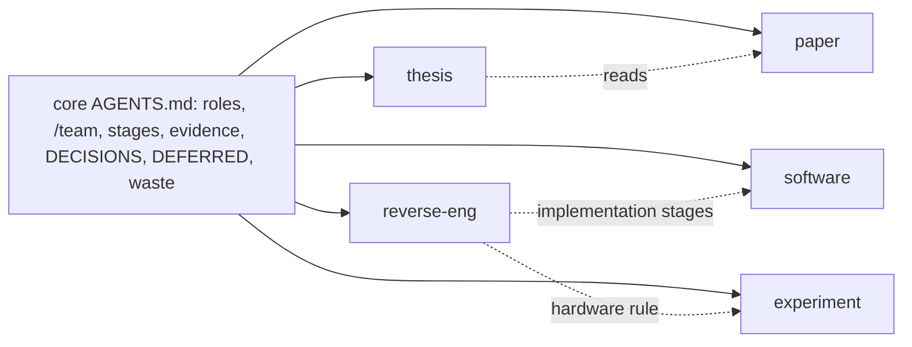
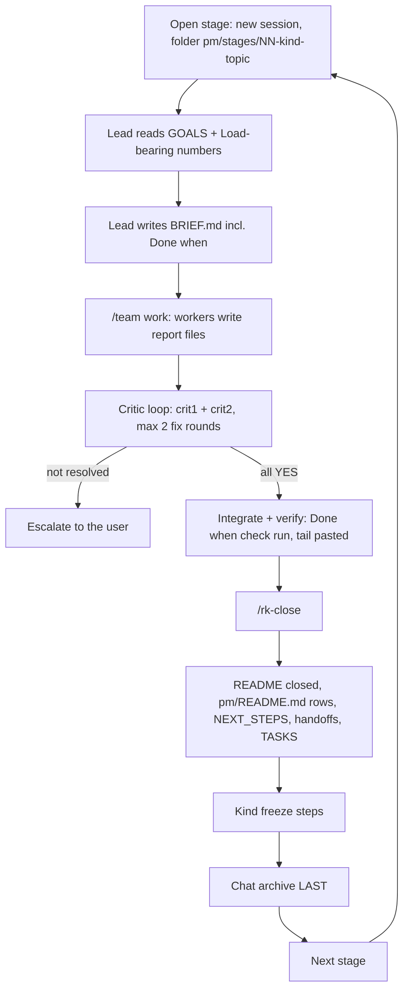
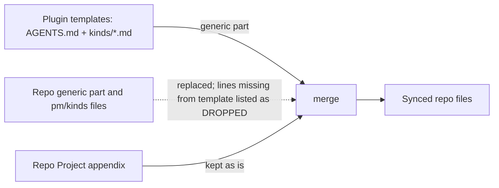
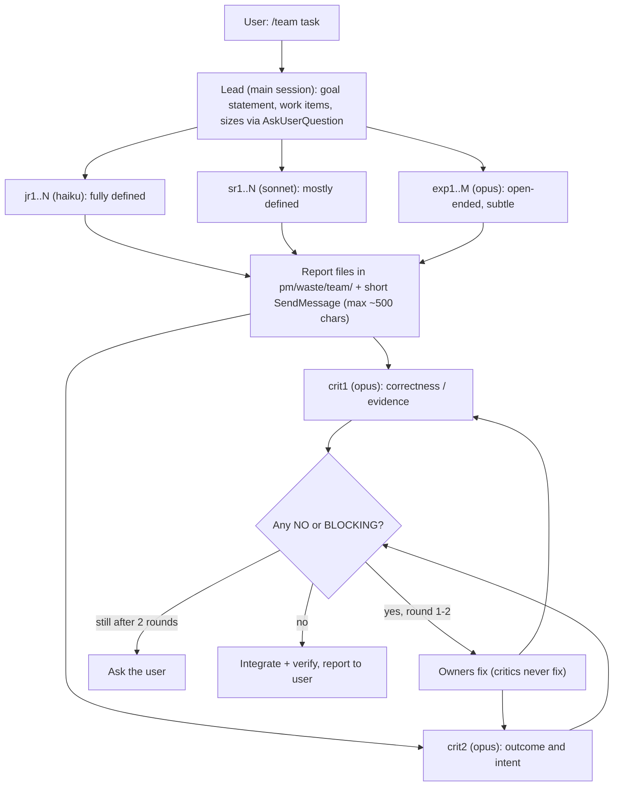

# research-kit

Built with AI assistance (Claude Code).

A Claude Code marketplace for running science and lab projects with agent
teams: papers, research software, driver reverse engineering, experiments and
theses, alone or mixed in one repo. It ships a generic process file
(`AGENTS.md`), one short rule file per project kind, a `pm/` process folder,
a `/team` skill (named workers plus two opus critics with different lenses),
worker agents pinned to an effort level, a "waste, don't delete" helper and
compaction handoff hooks.

License: MIT (see `LICENSE`).

## Plugins

| Plugin | Contents |
|---|---|
| `research-kit` (core) | skills `research-kit`, `team`, `waste`, `surviving-compaction`; commands `rk-*`, `s-comp`; agents `worker-{low,medium,high,xhigh}`; hooks; all kind files |
| `research-kit-lit` (optional) | skill `zotero` (tested Zotero MCP procedure, preflight, stop conditions), agent `zotero-worker`; for the `paper` and `thesis` kinds |

Skills also answer to their bare name (`/team`) unless another skill already
uses it. Agents only answer to the `research-kit:` name.

## Install

```
/plugin marketplace add xylophoneengine/research-kit
/plugin install research-kit@research-kit
/plugin install research-kit-lit@research-kit     # optional, Zotero users
```

Then restart Claude Code (or `/reload-plugins`). Requirements: `bash`, `jq`,
`python3` (stdlib only).

## Kinds

One file per kind, copied to `pm/kinds/<kind>.md` in your repo. Add kinds as
the repo grows; stages of different kinds can run in parallel.

| Kind | For | Core ideas |
|---|---|---|
| `paper` | writing a research paper | literature pipeline, writing stages, citation rules, reference manager |
| `software` | apps, libraries, tools built by an orchestrator plus implementers | spec and failing test first, tests never weakened, gate script, git policy |
| `reverse-eng` | reimplementing a vendor-closed driver or protocol | scope statement, pinned vendor material, capture first, `PROTOCOL.md`, fake transport and replay |
| `experiment` | measuring on a rig, instrument or simulator | agents never touch hardware unless the user explicitly tells them to, run records, dry runs not quotable, write-once analysis |
| `thesis` | assembling a thesis | paper kind plus carrying evidence tags and stage notes over from earlier projects |



Every kind file stays under about 150 lines and is read once per session; the
appendix of `AGENTS.md` lists the active kinds.

## Light vs full

Chosen at `/rk-init`, stored as `Mode:` in the appendix.

Light keeps roles, `/team`, both critics, evidence tags, `pm/DECISIONS.md`,
`pm/DEFERRED.md`, logs and handoffs; full adds stage folders, stage tables and
the close checklist.

`/rk-upgrade` turns light into full; nothing is downgraded.

## The `pm/` folder

```
pm/
  README.md         finding aid: stages, "Load-bearing numbers", "Do not quote"   committed
  DECISIONS.md      decision log + escalation format                              committed
  DEFERRED.md       parked items (approval, hardware, money)                      committed
  living/           GOALS, NEXT_STEPS, TASKS, edited in place                     committed
  kinds/            active kind files (replaced on sync)                          committed
  stages/NN-<kind>-<topic>/                                                       committed, except chat/
    README.md BRIEF.md deliverables/ notes/ code/ chat/                           chat/ gitignored
  handoffs/open/    work packages for later sessions                              committed
  handoffs/done/    executed work packages                                        committed
  handoffs/compact/ compaction handoffs                                           gitignored
  logs/             run and implementation logs                                   committed
  reviews/          critic reviews outside stages (light mode)                    gitignored
  scratch/          throwaway work                                                gitignored
  waste/            discarded files + LEDGER.md; team/ = teammate reports         gitignored
```

`rk-init` also appends a marked block to `.gitignore` (`pm/waste/`,
`pm/handoffs/compact/`, `pm/scratch/`, `pm/reviews/`, `pm/stages/*/chat/`,
`_dry/`); rerunning it never duplicates the block or touches your lines.

## Commands

| Command | Does |
|---|---|
| `/rk-init` | asks kinds, mode and git policy, then creates `pm/`, the appendix fields, the kinds block, the `.gitignore` block |
| `/rk-add-kind <kind>` | activates another kind (no-op if already active; unknown kind lists the valid ids) |
| `/rk-upgrade` | light to full: adds `pm/stages/`, flips `Mode:` |
| `/rk-sync` | updates `AGENTS.md` and the kind files from the plugin templates (see below) |
| `/rk-close` | closes a named stage with the close checklist |
| `/s-comp prepare` / `resume` | compaction handoff before and after `/compact` |

## Stage lifecycle

Every stage opens with a mechanical `Done when` check and ends with the close
checklist (chat archive last).



Side loops: `get ready for compact` writes a handoff, then `/compact`, then
resume from it.

## How sync works



- Dry run by default: prints one diff for `AGENTS.md` and every active kind file, writes nothing.
- `--write` is refused while DROPPED lines exist (repo lines the template lacks); sort them first: old template text is dropped, repo-specific text moves to the appendix, a generic improvement is back-ported to the template. `--accept-drop` overrides.
- Legacy single-file repos (older `paper-playbook` stamp) migrate on the same command: the generic part is replaced, the appendix kept, `pm/kinds/paper.md` and the `pm/` tree added. Nothing is moved: old stage folders and `WASTE/` stay put and are recorded as `Legacy stages:` / `Legacy waste:`.

To change a generic rule: edit the template in a clone of this repo, bump the
stamp (`<!-- research-kit: ... -->`) and the plugin `version`, push, update
the plugin, then sync each repo.

## /team flow



## Best practices for teams

- Name every teammate (`jr1`, `sr1`, `crit1`, ...): an unnamed spawn cannot be reached by `SendMessage`.
- Pick the model by how defined the task is (haiku / sonnet / opus); between two tiers, take the higher.
- The lead orchestrates and never does the legwork.
- Briefs open with `DELIVERABLE:` (artifact + exact path) and `NOT IN SCOPE:`.
- Full reports go to `pm/waste/team/<name>-r<round>.md` (gitignored; outside a `pm/` repo: the session scratchpad). The lead gets a message of 500 chars or fewer, and the teammate's final text is one line with the report path. Each report reaches the lead twice: once as the message and once as the idle notification.
- When reusing an idle teammate, restate the deliverable and the report lines.
- Critics never fix; owners fix; max 2 rounds, then ask the user.
- One `/team` task per session; `/clear` after it.
- The lead's context is the main cost driver (every teammate message re-reads it): compact deliberately (`/s-comp prepare`).
- Optional cost tip: a `~/.claude/agents/Explore.md` with `model: haiku` and `omitClaudeMd: true` overrides the built-in Explore agent.
- The advisor tool only pays off as a cheaper main model plus a stronger advisor. Skip it when the main model outranks the advisor.
- Keep the Mac awake (`caffeinate -i claude`) if you rely on auto-continue after usage-limit resets.

## Deleting is off

A `PreToolUse` hook (`hooks/guard-delete.sh`) denies Bash commands that
delete (`rm`, `rmdir`, `unlink`, `git rm`, `git clean`, `find -delete`, Python
`rmtree`/`os.remove`) and nothing is auto-allowed. The check is a text
heuristic that errs on the side of denying; temp files outside a repo are
simply left alone. Instead:

- Teammates never delete and never run the waste helper (their permission
  prompts do not reach you). They list each file in their report as a line at
  column 0: `TO-WASTE: <repo-relative path> -- <reason>`.
- Only the lead (main session) runs the helper, once, for the collected items:
  `grep -h '^TO-WASTE: ' <reports>/*.md`, then `skills/waste/waste.sh lead "<reason>" <paths>`.
  You approve each call; the prompt appears in the main session, so Remote
  Control users see it.
- The helper moves files to `pm/waste/<stamp>/` (`WASTE/` in legacy repos) with
  a ledger row. It refuses `.git`, `.claude`, `.env*`, the repo root, `pm`
  itself, its own plugin directory, symlinked waste dirs or ledgers, and paths
  with control characters.
- You empty the waste folder yourself.

## Optional external tools

Not bundled; install what your kinds use.

- ARS plugin (`academic-research-skills`): `/plugin marketplace add Imbad0202/academic-research-skills`, then install it. The `paper` and `thesis` stage tables run on it.
- `superpowers` plugin: the `software` stage table names its brainstorming, planning and subagent-driven-development skills; the rules hold without it.
- Zotero MCP: `zotero-mcp-server` (tested 0.15.2, https://github.com/54yyyu/zotero-mcp), server name `zotero`, env `ZOTERO_LOCAL=true`, `ZOTERO_SEARCH_BACKEND=sqlite`, `ZOTERO_API_KEY=""`. Details: `plugins/research-kit-lit/skills/zotero/SKILL.md`, section Setup.
- Serena MCP: symbol navigation; briefs tell workers to use it when the repo has `.serena/project.yml`.
- rea (https://github.com/morluto/rea, MIT): static-analysis MCP for binaries and firmware, optional for `reverse-eng`. Vet it before installing.

## Development

```
claude plugin validate .
claude plugin validate plugins/research-kit
claude plugin validate plugins/research-kit-lit
python3 -I plugins/research-kit/skills/research-kit/scripts/test_rk.py
bash scripts/anon_check.sh
claude --plugin-dir plugins/research-kit    # try it without installing
```
