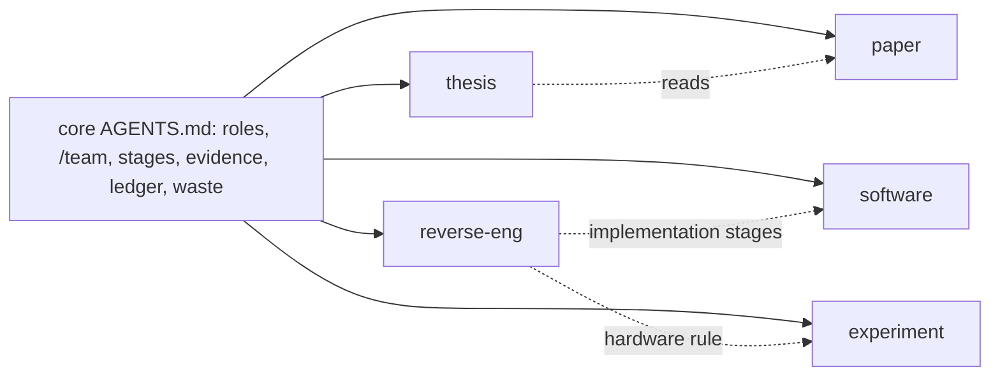
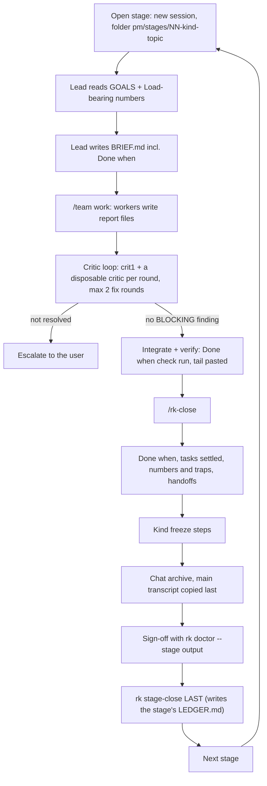
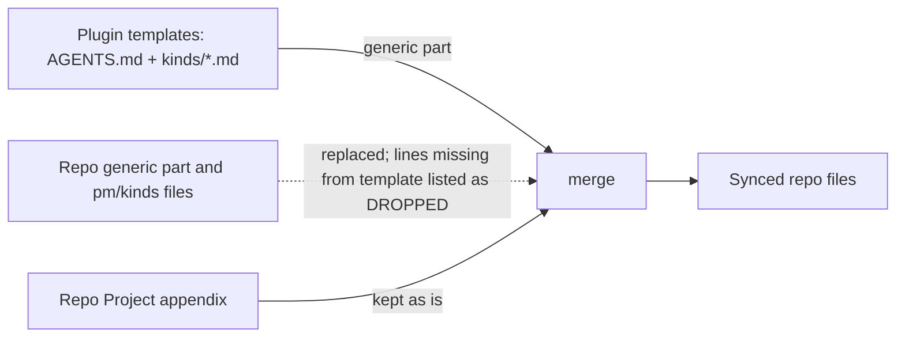
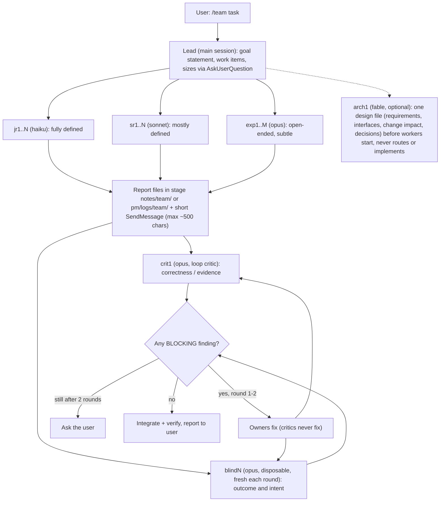
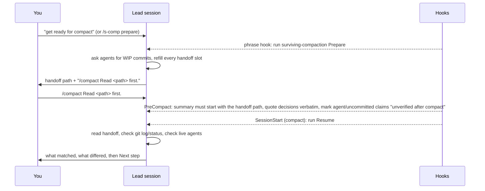

# research-kit

Built with AI assistance (Claude Code).

A Claude Code marketplace for running science and lab projects with agent
teams: papers, research software, driver reverse engineering, experiments and
theses, alone or mixed in one repo. It ships a generic process file
(`AGENTS.md`), one short rule file per project kind, a `pm/` process folder,
a `/team` skill (named workers, an optional architect and two opus critics with different lenses),
worker agents pinned to an effort level, a "waste, don't delete" helper,
compaction handoff hooks and a read-only ledger viewer.

License: MIT (see `LICENSE`).

## Contents

- [Plugins](#plugins)
- [Install](#install)
  - [Quick start](#quick-start)
  - [Enable agent teams (needed by `/team`)](#enable-agent-teams-needed-by-team)
  - [Updating](#updating)
- [Kinds](#kinds)
- [ARS integration (`paper`, `thesis`)](#ars-integration-paper-thesis)
- [Example: a paper with a code part, end to end](#example-a-paper-with-a-code-part-end-to-end)
- [Zotero (`research-kit-lit`)](#zotero-research-kit-lit)
- [Light vs full](#light-vs-full)
- [The `pm/` folder](#the-pm-folder)
- [Commands](#commands)
- [Stage lifecycle](#stage-lifecycle)
- [How sync works](#how-sync-works)
- [After a kit update](#after-a-kit-update)
- [/team flow](#team-flow)
- [Best practices for teams](#best-practices-for-teams)
- [Surviving compaction](#surviving-compaction)
- [Deleting is off](#deleting-is-off)
- [Optional external tools](#optional-external-tools)
- [Development](#development)

## Plugins

| Plugin | Contents |
|---|---|
| `research-kit` (core) | skills `research-kit`, `team`, `waste`, `surviving-compaction`; commands `rk-*`, `s-comp`; agents `worker-{low,medium,high,xhigh}`, `fetcher` (lean lookups); hooks; all kind files; the ledger viewer (`rk ui`, its built bundle in `skills/research-kit/ui/dist/`) |
| `research-kit-lit` (optional) | skill `zotero` (tested Zotero MCP procedure, preflight, stop conditions), agent `zotero-worker`; for the `paper` and `thesis` kinds |

The full name always works: `/research-kit:<name>` for commands and skills,
`research-kit:<name>` for agents. A skill also answers to its bare name (`/team`)
unless another command already uses that name; for commands and agents Claude
Code's docs promise only the prefixed name.

## Install

```
/plugin marketplace add xylophoneengine/research-kit
/plugin install research-kit@research-kit
/plugin install research-kit-lit@research-kit     # optional, Zotero users
```

From a local clone instead: `/plugin marketplace add /path/to/research-kit`.

Then restart Claude Code (or `/reload-plugins`). Requirements: `bash`, `jq`,
`python3` (stdlib only), `git`.

### Quick start

1. Enable agent teams (below), restart.
2. In your project repo (must be a git repo): `/rk-init`. Pick kinds, light or
   full, and who commits.
3. Start work: `/team <task>` (or `/team juniors=1 critics=1 <task>` for a
   small one). In full mode, open a stage first (`rk add stage <kind>-<topic>
   --open`, see Stage lifecycle).
4. Before a compact say `get ready for compact`; after it the session resumes
   from the handoff file.
5. When the plugin updates: `/rk-sync` (dry run), sort DROPPED lines, then
   `/rk-sync --write`.

### Enable agent teams (needed by `/team`)

`/team` spawns named teammates that stay addressable (`SendMessage`) and can be
reused across rounds. That is Claude Code's experimental agent-teams feature;
without it a named spawn is a one-shot subagent. Turn it on in
`~/.claude/settings.json` (merge into an existing `env` block):

```json
{
  "env": {
    "CLAUDE_CODE_EXPERIMENTAL_AGENT_TEAMS": "1"
  }
}
```

Restart Claude Code. Check: in a new session, `/team juniors=1 critics=0 <tiny task>`
should show a teammate named `jr1` that you can message after it finishes.

#### Teammate mode

`teammateMode` (in `/config`) decides where teammates run:

- `"in-process"` (recommended): teammates run inside the lead's session, no
  extra panes.
- Split-pane modes (`tmux`, `iterm`, `auto`): each teammate opens its own
  terminal pane. Readable for two or three teammates, crowded for a big team.

Teammates may start their own subagents (web lookups, fetches). `/team`
briefs make them use an agent type that can write files, run it in the
foreground and write results next to the teammate's report as
`<name>-r<round>-sub<k>.md` (the open stage's `notes/team/`; light mode or no
open stage: `pm/logs/team/<run>/`), so long results never land in the lead's
context.

Start Claude in a project folder you have trusted before: teammates start in
the lead's folder, and the home folder asks for trust every time.

### Updating

Plugins install as a copy. After pulling a new version (or editing a local
clone), run `claude plugin marketplace update research-kit`, then
`/plugin` -> update `research-kit` (and `research-kit-lit`), and restart.
Then bring each repo along: [After a kit update](#after-a-kit-update).

From 0.2.1: a ledger that holds a shelved entry needs kit 0.2.1 or newer in
every session that opens the repo. An older kit refuses it with an
unknown-status error: update the kit, do not edit the ledger line.

From 0.2.5: a ledger with a planned stage needs that kit in every session; an older kit refuses it with an unknown-status error.

## Kinds

One file per kind, copied to `pm/kinds/<kind>.md` in your repo. Add kinds as
the repo grows; stages of different kinds can run in parallel.

| Kind | For | Core ideas |
|---|---|---|
| `paper` | writing a research paper | literature pipeline, writing stages, citation rules, reference manager |
| `software` | apps, libraries, tools built by an orchestrator plus implementers | spec and failing test first, tests never weakened, gate script, git policy |
| `reverse-eng` | reimplementing a vendor-closed driver or protocol | scope statement, pinned vendor material, capture first, `PROTOCOL.md`, fake transport and replay |
| `experiment` | measuring on a rig, instrument or simulator | agents never touch hardware unless the user explicitly tells them to, run records, dry runs not quotable, write-once analysis |
| `thesis` | assembling a thesis | paper kind plus carrying evidence tags and stage notes over from earlier projects |



Every kind file stays under about 150 lines and is read once per session; the
appendix of `AGENTS.md` lists the active kinds.

## ARS integration (`paper`, `thesis`)

The `paper` kind runs its literature and writing stages on the
[academic-research-skills](https://github.com/Imbad0202/academic-research-skills)
plugin (ARS). Full rules: `pm/kinds/paper.md` sections P0, P2 and P5.8.

- First session in a paper repo: the lead checks ARS is installed and stops if not.
- ARS runs inside the team model, not beside it: interactive modes (plan,
  Socratic dialogue) run in the lead session; modes that write a deliverable run
  in a named teammate; critics review every ARS deliverable like any other.
- Invoke the parent skill with a mode argument on the session model (most light
  `/ars-*` commands pin a smaller model). Outputs go to the stage folder; the
  stage README records skill + mode + version.
- ARS reads your sources only through a Material Passport (`passport.yaml`)
  built from the ledger by a converter script and rebuilt after every ledger
  change; without it ARS searches external databases instead.

| Paper stage | ARS skill (mode) |
|---|---|
| goal + lit-scan | `deep-research` (`three-way-scan` / `lit-review`; `socratic` optional) |
| scan update | `deep-research` (`three-way-scan` / `lit-review` / `fact-check`) |
| plan | `academic-paper` (`plan`), lead session |
| outline | `academic-paper` (`outline-only`) |
| full draft | `academic-paper` (`full`); `academic-pipeline` only phase by phase |
| review | `academic-paper-reviewer` (`full` / `methodology-focus`) |
| revision | `academic-paper` (`revision` / `revision-coach` / `rebuttal-audit`), then reviewer `re-review` |
| finalize | `academic-paper` (`abstract-only`, `citation-check`, `disclosure`, `format-convert`) |
| systematic reviews only | `sr-screener` (ARS >= 3.23.0), on user request |

Seed, source-sync and benchmark stages use no ARS. The `thesis` kind reuses
the paper pipeline.

## Example: a paper with a code part, end to end

One repo, kinds `paper` + `software`, full mode. One stage per session; each
stage opens in a fresh session named after its folder (`/rename`).

| Session | You type | What happens |
|---|---|---|
| setup | `/rk-init` (kinds: paper; full; user commits) | `pm/` tree, appendix, `.gitignore` block. Paper first-session steps: ARS check, library tag asked (e.g. `mypaper`), appendix lines (title, venue, authors, topic) |
| 01 | `/rename MYP_01_paper_goal-scan`, then "open stage: goal + lit-scan" | Lead writes `BRIEF.md` with a `Done when`. Lead runs the GOALS dialogue (`deep-research`, `socratic`) and writes `pm/living/GOALS.md`; you confirm. `/team`: a teammate runs `deep-research` `three-way-scan` into `deliverables/`; `crit1` + a disposable critic review into `notes/` |
| | "close stage" (or `/rk-close 01`) | Close checklist: `Done when` output pasted; every stage task done, dropped, shelved, re-staged or deferred; `pm/README.md` numbers and traps; handoffs closed; kind freeze steps; chat archive (main transcript copied last); your sign-off asked with the `rk doctor --stage` output and logged as a decision; `rk stage-close` last. Stage is frozen |
| 02 | "open stage: source sync" | `/team` with `research-kit-lit:zotero-worker` teammates: preflight, import, tag, ledger = PDFs = library entries; corpus passport rebuilt for ARS |
| 03 | `/rk-add-kind software`, "open stage: software solver" | Software kind in parallel (one open stage per kind): design via `superpowers:brainstorming` or grilling, plan via `writing-plans`, build via `/team`; numbers stamped at a clean commit go to "Load-bearing numbers" in `pm/README.md` |
| 04 | "open stage: plan" | `academic-paper` `plan` in the lead session (dialogue with you): `chapter_plan.md`, `insight_collection.md`; your decisions logged in the ledger |
| 05-06 | "open stage: outline", then "full draft" | `academic-paper` `outline-only`, then `full`, each in a named writer teammate, reading the passport; every claim in `claims_register.md` has an owner file |
| 07-08 | "open stage: review", then "revision" | `academic-paper-reviewer` `full`, then `academic-paper` `revision` + reviewer `re-review` |
| 09 | "open stage: finalize" | `abstract-only`, `citation-check`, `disclosure`, `format-convert`; done when `citation-check` has no open error |

Any session: "get ready for compact" writes a handoff in `pm/handoffs/compact/`,
then `/compact`, and the session resumes from it. A blocker or a question only
you can answer goes to the ledger as a `deferred` entry (owner: user); the lead
asks instead of guessing. A decision is logged once you have made it.

After stage 03 the repo looks like:

```
pm/stages/01-paper-goal-scan/       closed: BRIEF, README, deliverables/scans, notes/critic reviews
pm/stages/02-paper-source-sync/     closed: ledger sync check, passport
pm/stages/03-software-solver/       open:   plan, code, run sheet, numbers
pm/living/GOALS.md  pm/living/paper_ledger.md  pm/README.md (Load-bearing numbers)
paper/library/pdfs/                 (manuscript/ appears at the draft stage)
```

Light mode works the same without stage folders: `/team` tasks, critics into
`pm/logs/team/<run>/`, the stage tables as a checklist.

## Zotero (`research-kit-lit`)

Optional add-on for kinds that keep a literature library. It drives
[Zotero](https://www.zotero.org) through the
[Zotero MCP server](https://github.com/54yyyu/zotero-mcp) (`zotero-mcp-server`,
tested 0.15.2) and enforces one hard rule: **PDF and file bodies never go to
zotero.org storage** (small quota); files sync through your own WebDAV server.

Setup, once per machine:

1. Zotero desktop: Settings > Sync > File Syncing = WebDAV (your server);
   Settings > Advanced > allow other applications to communicate with Zotero
   (local API on `127.0.0.1:23119`). Local MCP writes need a recent Zotero.
2. Install the server into its own environment (see its README), e.g.
   `python3 -m venv ~/venvs/zotero && ~/venvs/zotero/bin/pip install zotero-mcp-server`.
3. Register it with Claude Code under the name `zotero`, in local mode, with the
   SQLite search backend and an empty API key (the empty key masks any key your
   shell exports, so the MCP has no path to zotero.org):

   ```
   claude mcp add zotero -s user \
     -e ZOTERO_LOCAL=true -e ZOTERO_SEARCH_BACKEND=sqlite -e ZOTERO_API_KEY= \
     -- ~/venvs/zotero/bin/zotero-mcp
   ```
4. Optional, only for the preflight's `--file-check`: a read-only
   `ZOTERO_API_KEY` and `ZOTERO_LIBRARY_ID` exported in your shell, never in the
   MCP env.

Use:

- The `zotero` skill holds the tested procedure: preflight script
  (`skills/zotero/scripts/preflight.py`, run before the first write each
  session), recipes, stop conditions and pitfalls. Load it before any write.
- Teammates that touch Zotero run as agent type `research-kit-lit:zotero-worker`
  (stop conditions built in).
- Any doubt (hybrid/web mode, "Web API credentials: set", quota or zotero.org
  text in an error): the agent stops and asks you; it never works around it.
- Group libraries: WebDAV serves My Library only, so group items get tags, not
  attachments.

## Light vs full

Chosen at `/rk-init`, stored as `Mode:` in the appendix.

Light keeps roles, `/team`, the critics, evidence tags, the ledger, logs and
handoffs; full adds stage folders, stage tables and
the close checklist.

`/rk-upgrade` turns light into full; nothing is downgraded.

## The `pm/` folder

```
pm/
  README.md         finding aid: stages, "Load-bearing numbers", "Do not quote"   committed
  ledger.jsonl      tasks, decisions, deferred items, stages: append-only log      committed
  STATUS.md         generated open list + shelved, rebuilt after every write      gitignored
  living/           GOALS, edited in place                                        committed
  kinds/            active kind files (replaced on sync)                          committed
  stages/NN-<kind>-<topic>/                                                       committed, except chat/
    README.md BRIEF.md LEDGER.md deliverables/ notes/ code/ chat/                 chat/ gitignored
  handoffs/open/    work packages for later sessions                              committed
  handoffs/done/    executed work packages                                        committed
  handoffs/compact/ compaction handoffs + hook-made auto-<stamp>.md state files   gitignored
  logs/             run and implementation logs; team/<run>/ = teammate reports   committed
                    and critic reviews outside a stage (in a stage: notes/)
  reviews/          older critic reviews outside stages (light mode)              gitignored
  scratch/          throwaway work                                                gitignored
  waste/            discarded files + LEDGER.md                                   gitignored
```

### The ledger

Tasks, decisions, deferred items, fetches, debts, handoffs and stages live in one
append-only event log, `pm/ledger.jsonl`. Only the `rk.py` subcommands read or
write it (core AGENTS.md 4.2 defines the shorthand `rk`); a hook blocks hand
edits of the log and of `pm/STATUS.md`, and another refuses a team brief whose
`TASK:` ids are not open tasks. Every write prints a receipt such as
`logged D-41: ...`, and `pm/STATUS.md` is regenerated after it. Every event
carries the kit version and the session id (`rk show` prints them), the way
from an entry to the archived transcript. A `--ref` must name an existing file
in the repo (a `://` URL, `doi:` or `arXiv:` passes; a path outside the repo is
refused; an absolute path inside it is stored repo-relative; checked against
the main checkout, so in a worktree merge first). `close`, `drop`, `shelve` and
`reopen` also store their `--note` whole as the entry's `reason` (why it has its
current status; `rk show` prints it). `rk stage-close` writes the stage's
`pm/stages/<stage>/LEDGER.md`: generated, frozen with the stage, never edited by
hand; it shows what was known at close and a later `rk set` does not rewrite it.
A stage closed too early comes back with `rk reopen S-n --note "<why>"`
(refused while another stage of its kind is open, and for a stage without a
folder); its next `stage-close` needs a new sign-off and writes the record
again, with each open span and each reopen.

```
rk add <type> <title>       log a task, decision, deferred item, ...
rk add stage <kind>-<topic> plan a stage (--open: open now; --follows, --before, --after)
rk start|close|drop|reopen  change status (close and drop take --note)
rk shelve                   known, not planned now: leaves the open list (needs --note)
rk set | rk supersede       edit fields (--ref-drop PATH removes a wrong ref); replace a decision
                            --stage of every type but task and stage (e.g. debt, deferred, fetch,
                            handoff) = raised in: while open it may be put into a closed
                            stage by add, set or import, and start / reopen work there
                            (an open or running task cannot)
                            stages only: --status planned|shelved|dropped (--note needed),
                            --before|--after S-n (order planned stages)
rk list | show | search     open items (--all: closed and shelved; --status S: one status), one or more entries, text search
rk recent                   newest events
rk import FILE.jsonl        legacy history into the ledger, marked imported (--dry-run first)
rk ui [--port N]            read-only browser view of the ledger (see below)
rk doctor [--stage S-n]     read-only check of ledger, folders, git: exit 1 on hard findings
rk reref OLD NEW [--dry-run]   point refs at OLD to NEW, after a file was moved by hand
rk stage-open S-n [--follows S-m]   open a planned stage: next NN, folder renamed, refs rewritten
rk stage-rename S-n <kind>-<topic> [--note N]   rename the kind-topic part of a stage title (a done stage needs --note)
rk stage-close S-n --sign-off D-m   close a stage, last; runs the doctor --stage checks first
rk render                   rebuild pm/STATUS.md
rk brief-check              the brief gate the hook calls
```

`rk-init` also appends a marked block to `.gitignore` (`pm/waste/`,
`pm/handoffs/compact/`, `pm/scratch/`, `pm/reviews/`, `pm/stages/*/chat/`,
`pm/STATUS.md`, `_dry/`); rerunning it never duplicates the block or touches your lines.
It also writes a marked block into `.gitattributes` with `pm/ledger.jsonl merge=union`,
so branch merges of the append-only ledger do not conflict.

### The ledger viewer

`/rk-viewer` (or `rk ui` in a terminal) serves a read-only web page for
`pm/ledger.jsonl` and opens it in your browser. Tabs: list, board, stages and
timeline; a search box (also Ctrl/Cmd-K) finds an entry by id, title or note, and
a detail pane shows one entry with its history. The stages tab starts with the
plan: planned stages in queue order with their `~NN` forecast (from the kit, not
computed in the viewer), then shelved ones; an open or running entry whose linked
tasks are all done carries a `staged` badge (work done, not landed). It reads the ledger fresh on
every request and reloads when the tab regains focus; it never writes the ledger
or `pm/STATUS.md`. It listens on 127.0.0.1 only and has no login, so any user
logged in on the same machine can read the ledger while it runs. Port 8765 by
default, or the next free one up to 8774 when it is taken, but the start stops if a viewer of
the same repo already answers on one of those ports (`--port N` names
one; `--no-open`
skips the browser; `--repo DIR` names the repo). `/rk-viewer stop` ends the
viewer this session started; as a background task of the session it is expected
to end with it. It needs Python only: the built frontend is committed under
`skills/research-kit/ui/dist/`, and npm is needed only to rebuild it from
`skills/research-kit/ui/`. The build writes a hash of the source files into
`dist/src.sha256`; `test_ui.py` fails when that hash no longer matches the
source (it does not compare the bundle itself).

While it serves, the viewer keeps a small state file
`~/.cache/research-kit/ui/<port>.json` (pid, port, repo) and removes it when it
ends, also on SIGTERM. `rk ui --status` uses these files to list the running
viewers, one line `<port>  <repo>` each, or `no viewer runs`; it only reports a
viewer whose pid is alive and whose port answers as a viewer of that repo, and it
starts nothing. The browser tab is titled `rk ui · <repo folder> · :<port>`.

To see the viewer in Claude Code, use this line, the same on every machine, as
your status line command, or append its output to the one you have:

```
f=~/.cache/research-kit/ui/rk_path; [ -f "$f" ] && [ ! -L "$f" ] && [ -O "$f" ] && python3 -I "$(cat "$f")" ui --statusline
```

Each viewer start writes the path of its own `rk.py` into that file (next to the
state files, in a directory only you can write), so the line follows a plugin
update; it runs the path stored there, and only if the file is a regular file
owned by you and not a symlink. Nothing is printed until a viewer has been
started once on the machine. If the stored path no longer exists (a plugin
version was removed), the line prints a Python error on stderr until the next
viewer start rewrites the file. The line is safe as long as no other account can
write your home directory or `~/.cache`; the viewer creates the directories it
needs (`~/.cache` if missing, `research-kit`, `ui`) private. The line prints `🔍rk:<port>` when a viewer of the repo you are in
runs (the repo is taken from the `workspace.current_dir` or `cwd` of the JSON that
Claude Code pipes to a status line command, else from the current directory), and
nothing at all otherwise, so it adds no clutter in other sessions. The segment is
an OSC 8 terminal hyperlink to `http://127.0.0.1:<port>/`: clickable in terminals
that support OSC 8 links, plain text elsewhere. It does no probe
and checks only that the pid is alive, so a reused pid could show a stale port;
`--status` does the full check. The plugin does not set a status line by itself.

## Commands

The table shows short names, which Claude Code's docs do not promise for
commands. If a session answers `Unknown command` or runs another command, use
the full name `/research-kit:<name>`, for example `/research-kit:rk-viewer`.

| Command | Does |
|---|---|
| `/rk` | menu: shows the options below for the repo's state and runs your choice (start here). Full name `/research-kit:rk`; on first use it offers a personal `/rk` shortcut (`~/.claude/commands/rk.md`) so it ranks first in the slash menu |
| `/rk-init` | asks kinds, mode and git policy, then creates `pm/`, the appendix fields, the kinds block, the `.gitignore` block |
| `/rk-add-kind <kind>` | activates another kind (no-op if already active; unknown kind lists the valid ids) |
| `/rk-upgrade` | light to full: adds `pm/stages/`, flips `Mode:` |
| `/rk-sync` | updates `AGENTS.md` and the kind files from the plugin templates (see below) |
| `/rk-close` | closes a named stage with the close checklist |
| `/rk-doctor` | checks the ledger and its refs (`rk doctor`), read-only; `--stage S-n`, `--limit 0` |
| `/rk-viewer` / `/rk-viewer stop` | starts or stops the ledger viewer (see [The ledger viewer](#the-ledger-viewer)); `--port N`, `--repo DIR` |
| `/s-comp prepare` / `resume` | compaction handoff before and after `/compact` |

## Stage lifecycle

Every stage opens with a mechanical `Done when` check and ends with the close
checklist (`rk stage-close` last).



Side loops: `get ready for compact` writes a handoff, then `/compact`, then
resume from it (see [Surviving compaction](#surviving-compaction)).

## How sync works



- Dry run by default: prints one diff for `AGENTS.md` and every active kind file, writes nothing.
- `--write` is refused while DROPPED lines exist (repo lines the template lacks); sort them first: old template text is dropped, repo-specific text moves to the appendix, a generic improvement is back-ported to the template. `--accept-drop` overrides.
- Legacy single-file repos (older `paper-playbook` stamp) migrate on the same command: the generic part is replaced, the appendix kept, `pm/kinds/paper.md` and the `pm/` tree added. Nothing is moved: old stage folders and `WASTE/` stay put and are recorded as `Legacy stages:` / `Legacy waste:`.

To change a generic rule: edit the template in a clone of this repo, bump the
stamp (`<!-- research-kit: ... -->`) and the plugin `version` (the release
gate refuses a push that misses either, see [Development](#development)),
push, update the plugin, then sync each repo.

## After a kit update

In every repo, after updating the plugin, in this order (each step is safe to
repeat):

1. Start from a clean `git status`, so the kit step is one reviewable commit.
2. Start a session: its start line names the kit version and each rule file
   that is behind the kit.
3. `/rk-sync`: dry run, sort the DROPPED lines, then `--write`. It updates the
   rule files, the kit blocks and missing `pm/` folders; a second run prints
   `up to date`.
4. `rk doctor` is the to-do list: HARD findings first, then SOFT.
5. Fix each finding with ordinary commands: `rk set`, `rk close`, and
   `rk reref OLD NEW` after you moved a file by hand (move first, then fix the
   ref; the tool never moves or deletes repo files).
6. Log one decision for the kit step: what it changed in this repo, linked to
   the stages it touched, with `--stage S-<n>` of the last stage it touched
   (else `rk doctor` lists it as an entry without stage; check
   `rk search "kit step"` first).
7. `rk doctor` again; name any remaining SOFT lines in that decision's note.
8. Commit the ledger, the rule files and the moved files.

A new kit never reports HARD on what an older kit wrote correctly: HARD is
kept for what is broken under every version (a line that does not parse, a ref
to nothing, a missing stage folder, a ledger that was not only appended to).
Old events are never rewritten or back-filled; a clean `rk doctor` is the proof.

## /team flow



## Best practices for teams

- Name every teammate (`jr1`, `sr1`, `crit1`, ...): an unnamed spawn cannot be reached by `SendMessage`.
- Pick the model by how defined the task is (haiku / sonnet / opus); between two tiers, take the higher.
- The lead orchestrates and never does the legwork.
- Briefs open with `DELIVERABLE:` (artifact + exact path) and `NOT IN SCOPE:`.
- Teammates run only one-line read commands, the named check, one-line `rk` commands and one-line writes in their own scratch folder; anything else goes to the lead as plain lines in a file, which the lead runs inline, never as a script (a teammate's permission prompt may never reach you).
- Full reports go to `<REPORTS>/<name>-r<round>.md`: the open stage's `notes/team/` in full mode, `pm/logs/team/<run>/` in light mode or with no open stage (`<run>` = start time `YYYY-MM-DD-HHMM`), outside a `pm/` repo the session scratchpad. `<round>` is the next free number for that name, so a report is never overwritten. Reports are committed, never in `pm/waste/`: a ledger ref to a report must outlive the waste folder. The lead gets a message of 500 chars or fewer, and the teammate's final text is one line with the report path. Each report reaches the lead twice: once as the message and once as the idle notification.
- Critics write their review to the open stage's `notes/` (committed) or, with no open stage, `pm/logs/team/<run>/` (committed).
- Files to discard: teammates list `TO-WASTE:` lines in their report; the lead collects them with one grep (see Deleting is off).
- When reusing an idle teammate, restate the deliverable and the report lines.
- Critics never fix; owners fix; max 2 rounds, then ask the user.
- One `/team` task per session; `/clear` after it.
- The lead's context is the main cost driver (every teammate message re-reads it): compact deliberately (`/s-comp prepare`).
- Optional cost tip: a `~/.claude/agents/Explore.md` with `model: haiku` and `omitClaudeMd: true` overrides the built-in Explore agent.
- The advisor tool only pays off as a cheaper main model plus a stronger advisor. Skip it when the main model outranks the advisor.
- Keep the Mac awake (`caffeinate -i claude`) if you rely on auto-continue after usage-limit resets.

## Surviving compaction

**Why.** Long sessions (a `/team` stage, a lead orchestrating many teammates)
fill the context window, and Claude Code then compacts: the conversation is
replaced by a summary. Summaries are lossy in exactly the wrong places. Your
decisions get paraphrased, "tests green" loses the log that proves it, and
"jr2 is still running" survives as a claim although the agent may be gone with
its work uncommitted. The fix: **files and commits are the store; the summary
is only an index**, and after a compact it is a hypothesis until checked.

**What.** One handoff file per session,
`pm/handoffs/compact/handoff-YYYY-MM-DD.md` (gitignored), with six required
slots (write "none" when empty):

| Slot | Holds |
|---|---|
| User decisions and rules | verbatim quotes, safety rules first |
| Done | what + commit hash or log file path |
| In flight | per agent: name, worktree/branch, brief file, last commit, uncommitted file count, last known state |
| Open questions for the user | |
| Instructions given to the user | path of the file holding them |
| Next step | one action with its precondition |

The lead keeps it current **as it goes**, because a compact can arrive
unannounced: brief saved to a file before spawning an agent, your decisions
quoted in when you make them, test output redirected to a log and the path
noted.

**How.** Three hooks do the plumbing; you only say one sentence and type one
command:



- In a repo with `pm/ledger.jsonl` the PreCompact hook itself also writes `pm/handoffs/compact/auto-<stamp>.md` (`rk list`, `rk recent -n 30`, `git status --short`), so a compact nobody announced still leaves a state file; the resume line names the newest one next to your handoff. A failed write is silent.
- rk-init/rk-sync keep a marked `## Compact Instructions` block in CLAUDE.md; Claude Code reads it on every compact, including auto-compact.
- Trigger phrases: "get ready for compact", "ready for compaction",
  "prepare for compact", "I'm stopping here" (short messages only, so a pasted
  report that quotes them does not fire it). Or `/s-comp prepare` /
  `/s-comp resume` (`/rk` -> Compaction handoff).
- Resume restarts an agent only if it is no longer listed, from its brief file
  plus last commit; a listed agent is messaged instead (two agents in one
  worktree is the classic failure).
- A detail missing from the handoff is recovered from the session transcript,
  never from memory.
- Cost tip: the lead's context is the main cost driver; compacting
  deliberately at a stage boundary is cheaper than letting it auto-compact
  mid-task.

## Deleting is off

A `PreToolUse` hook (`hooks/guard-delete.sh`) denies Bash commands that
delete (`rm`, `rmdir`, `unlink`, `git rm`, `git clean`, `find -delete`, Python
`rmtree`/`os.remove`) and nothing is auto-allowed. The check is a text
heuristic that errs on the side of denying; temp files outside a repo are
simply left alone. Instead:

- Teammates never delete and never run the waste helper (their permission
  prompts do not reach you; the hook also denies the helper for subagent
  calls). They list each file in their report as a line at column 0:
  `TO-WASTE: <repo-relative path> -- <reason>`.
- Only the lead (main session) runs the helper, once, for the collected items:
  `grep -h '^TO-WASTE: ' <reports of this wave>`, then `skills/waste/waste.sh lead "<reason>" <paths>`.
  You approve each call; the prompt appears in the main session, so Remote
  Control users see it.
- The helper moves files to `pm/waste/<stamp>/` (`WASTE/` in legacy repos) with
  a ledger row. It refuses: the repo root, `pm` itself, anything in or
  containing `.git`, `.claude`, `.claude-plugin`, `.env` / `.env.*` (examples
  and templates allowed), any `.gitignore`, its own plugin files, symlinked
  waste dirs or ledgers, a waste dir git does not ignore (run `/rk-init` or
  add it to `.gitignore`), paths outside a git repo, and names with control
  characters.
- You empty the waste folder yourself.

## Optional external tools

Not bundled; install what your kinds use.

- ARS plugin (`academic-research-skills`): `/plugin marketplace add Imbad0202/academic-research-skills`, then install it. The `paper` and `thesis` stage tables run on it.
- `superpowers` plugin (`/plugin install superpowers@claude-plugins-official`): the `software` stage table names its brainstorming, planning and subagent-driven-development skills; the rules hold without it.
- `grill-me` / `grilling` skills (third-party, https://www.skills.sh/mattpocock/skills/grill-me): optional alternative to brainstorming for the `software` design stage; install into `~/.claude/skills/`.
- Zotero MCP (https://github.com/54yyyu/zotero-mcp): needed by `research-kit-lit`; setup in the Zotero section above.
- Serena MCP: symbol navigation; briefs tell workers to use it when the repo has `.serena/project.yml`.
- rea (https://github.com/morluto/rea, MIT): static-analysis MCP for binaries and firmware, optional for `reverse-eng`. Vet it before installing.

## Development

```
git config core.hooksPath scripts/githooks   # once per clone: every push runs the gate
bash scripts/release_check.sh                # the gate by hand (default: what a push of this branch would send)
bash scripts/test-release-check.sh           # tests for the gate
claude --plugin-dir plugins/research-kit     # try it without installing
```

`scripts/release_check.sh` stops at the first failure: plugin `version` not
bumped against `origin/main` when `plugins/<name>/` changed; a changed template
without a new stamp; the anon check; every `test-*.sh` / `test_*.py` under
`plugins/` and `scripts/`, run on the pushed commit, and again with `/bin/bash` and
`/usr/bin/python3` in a bare environment when those differ from the ones on PATH;
`claude plugin validate`
for the marketplace and each plugin.

`scripts/anon_check.sh` scans what a push publishes (added lines of every file,
also those git treats as binary; added file names; messages, author and
committer of each commit; annotated tags pointing into the range; and, from
the hook, the local and remote name of every pushed ref and each pushed tag;
`--all` for all history) for home and temp paths (also in `file://` URLs),
email addresses, secret shapes and session ids, and for the terms in the
private denylist `docs/private/denylist.txt` of the main checkout (any worktree
finds it; `ANON_DENYLIST` overrides). A multi-word term is also found when a
line wrap splits it. Without a denylist it fails; `--no-denylist` runs the
pattern scans only and says so. An added file that is not UTF-8 text (NUL
byte, other encoding) is a hit unless a `binary:<glob>` entry names it.
Owner rule of this repo: one pseudonymous identity publishes, so every commit
must carry the author and committer of `origin/main`'s tip. Accepted pattern
hits go into `scripts/anon_allow.txt`, one per line with a comment why; an
entry excuses only the exact text it matches, and a denylist hit cannot be
excused (change the denylist instead). The gate and the hook read the
allowlist from the commit being pushed, a manual `anon_check.sh` from the
working tree; the output names which.
